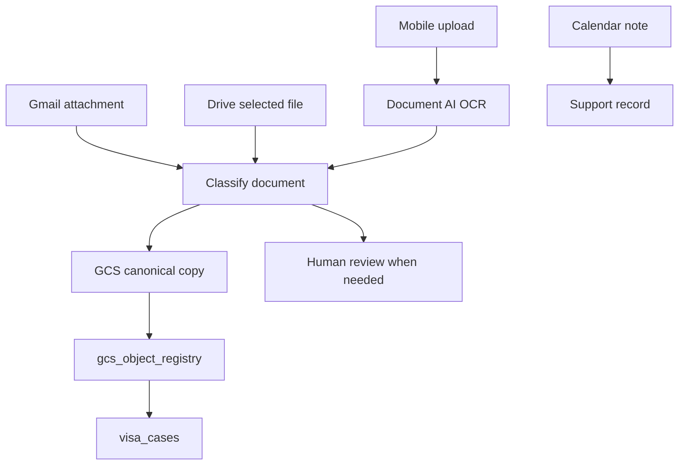

# SuguVisa スーパーアプリ / SuguVisa Super App / Super App SuguVisa

## 目的 / Purpose / Tujuan

SuguVisa を、ビザ申請書類の作成だけでなく、期限管理、Google Calendar 同期、Gmail / Drive 書類取込、GCS 原本台帳、専門家レビュー、分析まで一体化した日常業務アプリにする。

Turn SuguVisa into a daily operations app that combines visa document generation, deadline management, Google Calendar sync, Gmail / Drive intake, GCS evidence registry, expert review, and analytics.

Menjadikan SuguVisa aplikasi operasional harian yang menggabungkan pembuatan dokumen visa, manajemen tenggat, sinkronisasi Google Calendar, intake Gmail / Drive, registry bukti GCS, review ahli, dan analitik.

## Calendar MVP / カレンダーMVP / MVP Kalender

| 対象 / Target / Target | Source | Calendar behavior |
| --- | --- | --- |
| 在留期限 / Visa expiry / Masa berlaku visa | `visa_cases.visa_expiry` | 90 / 60 / 30 / 14 / 3 / 1 日前に通知 |
| 更新開始 / Renewal window / Mulai perpanjangan | `case_deadlines.deadline_date` | 更新準備開始日を予定化 |
| 14日届出 / 14-day notification / Notifikasi 14 hari | `case_deadlines.deadline_date` | 緊急イベントとして予定化 |
| 定期届出 / Periodic report / Laporan berkala | `case_deadlines.deadline_date` | 4/1〜5/31 期間を管理 |
| 定期面談 / Support meeting / Wawancara dukungan | `support_records.scheduled_at` | Free/busy と Meet を使って予約 |
| 書類回収 / Document collection / Pengumpulan dokumen | `case_deadlines.deadline_date` | 相手別に催促予定を作成 |
| 専門家レビュー / Expert review / Review ahli | `expert_review_queue` | レビュー期限を担当者予定へ反映 |

重複防止は `calendar_sync_links` に `tenant_id`, `source_table`, `source_id`, `deadline_type`, `provider_event_id` を保存して行う。

Deduplication is handled by `calendar_sync_links` with `tenant_id`, `source_table`, `source_id`, `deadline_type`, and `provider_event_id`.

Dedup dilakukan melalui `calendar_sync_links` dengan `tenant_id`, `source_table`, `source_id`, `deadline_type`, dan `provider_event_id`.

## Workspace MCP / Workspace連携 / Integrasi Workspace

| 接続 / Connection / Koneksi | MVP | 方針 / Policy / Kebijakan |
| --- | --- | --- |
| Google Calendar official MCP | Yes | AI が空き時間確認・予定確認を行う。書き込みはSuguVisaの期限に限定 |
| Google Calendar API | Yes | サーバー側で event ID、Meet、通知、重複防止を制御 |
| Google Drive API | Yes | ユーザー選択ファイルとSuguVisa作成フォルダだけを対象 |
| Google Meet | Yes | 面談・専門家レビュー予約に自動付与 |
| Gmail API | Later | 強い権限なので下書き・添付取込から段階導入。自動送信は禁止 |

## Role-Aware Home / 立場別ホーム / Beranda Berdasarkan Peran

| 立場 / Role / Peran | ホームの焦点 / Home focus / Fokus beranda |
| --- | --- |
| 外国人本人 / Foreign worker / Pekerja asing | 自分が集める書類、就労できる範囲、申請費用、期限、面談予約、やさしい多言語案内 |
| 登録支援機関 / Support organization / Organisasi pendukung | 支援計画、定期面談、随時届出、支援記録 |
| 所属機関 / Accepting organization / Organisasi penerima | 会社側書類、雇用条件、協議会、社保・税 |
| 派遣元 / Dispatching organization / Perusahaan pengirim | 派遣固有書類、14日届出、派遣元/派遣先/本人の分担、契約満了、勤怠・請求 |
| 派遣先 / Dispatch client / Klien penerima | 派遣先が提出・署名・押印する資料だけ |
| 行政書士・弁護士 / Expert / Ahli | 根拠、未確認点、補正リスク、証拠バインダー |
| 事務担当 / Admin / Admin | 今日の作業、不足情報、書類回収、提出前チェック |

## AI Case Concierge / AI案件コンシェルジュ / Concierge Kasus AI

AI Case Concierge は `visa_cases`, `case_deadlines`, `gcs_object_registry`, `calendar_sync_links`, `document_intake_events`, `expert_review_queue`, `legal_search.grounding_level`, `user_role` を入力にして、担当者ごとの次アクションを返す。

AI Case Concierge uses `visa_cases`, `case_deadlines`, `gcs_object_registry`, `calendar_sync_links`, `document_intake_events`, `expert_review_queue`, `legal_search.grounding_level`, and `user_role` to produce role-specific next actions.

AI Case Concierge memakai `visa_cases`, `case_deadlines`, `gcs_object_registry`, `calendar_sync_links`, `document_intake_events`, `expert_review_queue`, `legal_search.grounding_level`, dan `user_role` untuk menghasilkan aksi berikutnya sesuai peran.

| 出力 / Output / Output | 内容 / Meaning / Isi |
| --- | --- |
| `today_next_action` | 今日やるべき1つの最重要アクション |
| `missing_documents_by_party` | 本人・会社・派遣先・専門家の誰待ちか |
| `deadline_risk` | 期限超過、14日届出、更新開始などのリスク |
| `calendar_booking_suggestion` | 面談・レビュー・書類確認の予約提案 |
| `draft_message` | Gmail / Slack / WhatsApp 用の下書き |
| `grounded_legal_warning` | 一次情報根拠付きの注意喚起 |
| `expert_review_needed` | 人間レビューが必要な理由 |

## Intake Pipeline / 取込パイプライン / Pipeline Intake

画像PIIは原則としてアプリ側で永続保存しない。正本として保存が必要な原本は `gcs_object_registry` に lifecycle, source_system, retention_class, linked_sql_table を記録する。

Raw image PII is not persisted by default. Canonical evidence that must be retained is tracked in `gcs_object_registry` with lifecycle, source system, retention class, and linked SQL record.

PII gambar mentah tidak disimpan secara default. Bukti kanonik yang harus disimpan dilacak di `gcs_object_registry` dengan lifecycle, source system, retention class, dan relasi SQL.

## Expert Review Queue / 専門家レビュー / Antrean Review Ahli

| Trigger | Severity | Route |
| --- | --- | --- |
| RAG根拠なしで最新法令判断が必要 | high | 行政書士 |
| 申請中就労・期限超過・特例期間 | critical | 弁護士 |
| オンライン申請を在留期限当日に行おうとしている | critical | 行政書士 |
| 不法就労示唆・業務内容不一致・虚偽申請につながる相談 | critical | 弁護士 |
| 留学からの変更で出席率80%未満または理由不明確 | high | 行政書士 |
| 派遣適法性・派遣先変更14日届出 | critical | 行政書士 |
| 期限超過・残日数1日以下 | high | 管理者 |
| 必須書類の正本リンクなし | medium | 事務担当 |

## SSW Practical Rules / 特定技能実務ルール / Aturan Praktis SSW

留学から特定技能1号への変更では、出席率80%以上を安全ラインとし、出席票・成績表・卒業証明書または中退理由書を確認する。80%未満でもインフルエンザやCOVID-19等の合理的理由が短期間で証明できる場合は理由書で補足し、50%前後など就労目的の欠席が疑われる場合は帰国後ルートまたは専門家レビューへ回す。

For student-to-SSW1 changes, SuguVisa treats 80% attendance as the safe threshold and checks attendance records, transcripts, graduation certificates, or withdrawal reason letters. Lower attendance can be explained only with reasonable short-term evidence such as influenza or COVID-19; very low attendance or suspected work-first absence is routed to return-home options or expert review.

Untuk perubahan dari visa pelajar ke SSW1, SuguVisa memakai kehadiran 80% sebagai batas aman dan memeriksa catatan kehadiran, nilai, surat kelulusan, atau alasan berhenti sekolah. Kehadiran rendah hanya dapat dijelaskan dengan bukti alasan singkat yang wajar seperti influenza atau COVID-19; kehadiran sangat rendah atau dugaan bolos untuk bekerja diarahkan ke opsi pulang dulu atau review ahli.

一括申請Excelは公式XLSMのマクロを壊さず入力欄だけを埋める。初心者には操作手順、経験者には差分確認を返し、外国人の理解言語に合わせた母国語併記書類を必ず確認する。

Bulk application Excel generation preserves official XLSM macros and writes only input cells. Beginners receive operation steps, experienced users receive delta checks, and native-language document requirements are always checked against the applicant's understood language.

Pembuatan Excel aplikasi massal mempertahankan macro XLSM resmi dan hanya mengisi sel input. Pemula mendapat langkah operasi, pengguna berpengalaman mendapat pemeriksaan perbedaan, dan dokumen dengan bahasa ibu selalu diperiksa sesuai bahasa yang dipahami pemohon.

## Analytics / 分析 / Analitik

| KPI | 目標 / Target / Target |
| --- | --- |
| `deadline_overdue_count` | 0 |
| `dispatch_14day_miss_rate` | 0 |
| `document_collection_lead_time` | 短縮 |
| `revision_required_rate` | 低下 |
| `grounded_answer_rate` | 向上 |
| `support_meeting_completion_rate` | 向上 |

BigQuery / Looker Studio では、`case_deadlines`, `visa_cases`, `gcs_object_registry`, `submission_outcomes`, `visa_audit_logs`, `super_app_kpi_snapshots` を集計対象にする。

BigQuery / Looker Studio should aggregate `case_deadlines`, `visa_cases`, `gcs_object_registry`, `submission_outcomes`, `visa_audit_logs`, and `super_app_kpi_snapshots`.

BigQuery / Looker Studio mengagregasi `case_deadlines`, `visa_cases`, `gcs_object_registry`, `submission_outcomes`, `visa_audit_logs`, dan `super_app_kpi_snapshots`.

